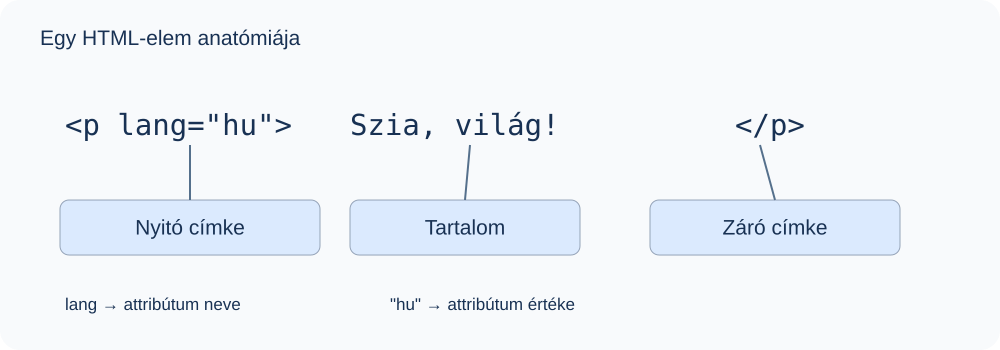

# 1. Bevezetés a HTML-be

## Mit fogsz megtanulni?

Megismered a HTML szerepét, az elemek felépítését, az attribútumokat és az elemek egymásba ágyazását.

## Mi a HTML?

A **HTML** a *HyperText Markup Language*, magyarul hiperszöveges jelölőnyelv rövidítése. A weboldal tartalmát és szerkezetét írja le: megmutatja, mi a cím, melyik szöveg bekezdés, hol van kép vagy hivatkozás. Nem programozási nyelv: önmagában nem ír le elágazásokat és ciklusokat.

A HTML-dokumentum szöveges fájl, általában `.html` kiterjesztéssel. Szövegszerkesztőben készítjük, a böngésző pedig értelmezi és megjeleníti.

| Technológia | Feladata | Példa |
| --- | --- | --- |
| HTML | Tartalom és szerkezet | Egy bekezdés és egy kép |
| CSS | Megjelenés | Színek, térközök, elrendezés |
| JavaScript | Működés | Gombnyomásra változó tartalom |

## Egy HTML-elem részei

```html
<p lang="hu">Szia, világ!</p>
```



| Részlet | Megnevezés | Jelentés |
| --- | --- | --- |
| `<p lang="hu">` | Nyitó címke | Itt kezdődik a bekezdés |
| `p` | Elem neve | Bekezdés |
| `lang` | Attribútum neve | A tartalom nyelve |
| `"hu"` | Attribútum értéke | Magyar |
| `Szia, világ!` | Tartalom | A megjelenő szöveg |
| `</p>` | Záró címke | Itt végződik a bekezdés |

Az **elem** a teljes szerkezeti egység; a **címke** annak nyitó vagy záró jelölése. Az attribútumokat a nyitó címkébe írjuk, egymástól szóközzel elválasztva. Az értékek körül a példákban egyenes idézőjelet (`"`) használunk.

## Páros és üres elemek

A páros elemeknek nyitó és záró címkéjük van:

```html
<h1>Az első weboldalam</h1>
<p>Ez egy bekezdés.</p>
```

Az **üres elemek** (*void elements*) nem tartalmazhatnak gyermekelemet vagy szöveget, és nincs záró címkéjük:

```html
<br>
<hr>

```

::: warning Fontos különbség
HTML-ben az `` végén szereplő perjel nem teszi „önlezáróvá” az elemet: az `img` eleve üres elem. Ne írj `</img>` címkét! A nem üres elemeket, például a `p` elemet, nem zárhatod le `<p />` alakban.
:::

## Egymásba ágyazás

Az elemek tartalmazhatnak más elemeket, ha a HTML tartalmi szabályai ezt engedik. A belső elemet a külső előtt zárjuk le:

```html
<p>Ez egy <strong>fontos</strong> mondat.</p>
```

A `p` a `strong` szülője, a `strong` a `p` gyermeke. A behúzás segít felismerni a szerkezetet, de önmagában nem hoz létre kapcsolatot.

## Blokkszintű és sorközi megjelenés

| Szokásos megjelenés | Viselkedés | Példák |
| --- | --- | --- |
| Blokkszintű | Új sorban kezdődik; általában kitölti a rendelkezésre álló szélességet | `p`, `h1`, `ul` |
| Sorközi | A szöveg folyásába illeszkedik | `strong`, `em`, `a`, `img` |

Ez az alapértelmezett megjelenést írja le; CSS-sel módosítható. Nem helyettesíti a HTML szabályait arra, hogy melyik elem mibe ágyazható. A táblázatok elemeinek külön megjelenítési szerepük van.

::: normal-demo Blokk és sorközi elem
```html
<p>Első bekezdés, benne <strong>fontos szöveg</strong>.</p>
<p>Második bekezdés, új sorban.</p>
```
:::

## Gyakorlás

1. Írj bekezdést a neveddel, és emeld ki benne a vezetéknevedet `strong` elemmel!
2. Add meg a bekezdés nyelvét!
3. Sorold fel a kódod nyitó és záró címkéit!

::: details Egy lehetséges megoldás
```html
<p lang="hu"><strong>Gipsz</strong> Jakab</p>
```
A nyitó címkék: `<p lang="hu">`, `<strong>`. A záró címkék: `</strong>`, `</p>`.
:::

