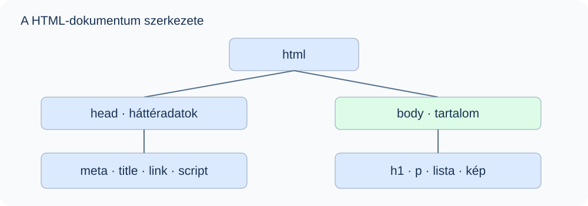

# 2. A HTML-oldal felépítése

## Mit fogsz megtanulni?

Elkészíted az első teljes HTML-dokumentumodat, és megkülönbözteted a háttéradatokat a látható tartalomtól.

## A dokumentum alapváza

Hozz létre `index.html` nevű fájlt, mentsd UTF-8 kódolással, majd nyisd meg böngészőben!

```html
<!DOCTYPE html>
<html lang="hu">
<head>
  <meta charset="utf-8">
  <meta name="viewport" content="width=device-width, initial-scale=1">
  <meta name="description" content="Az első HTML-oldalam.">
  <title>Első weboldalam</title>
</head>
<body>
  <h1>Üdvözöllek!</h1>
  <p>Most tanulok weboldalt készíteni.</p>
</body>
</html>
```



| Rész | Feladat |
| --- | --- |
| `<!DOCTYPE html>` | Dokumentumtípus-deklaráció; szabványos megjelenítési módot kér |
| `html` | A dokumentum gyökéreleme |
| `lang="hu"` | A dokumentum elsődleges nyelve |
| `head` | Metaadatok, cím és kapcsolódó erőforrások |
| `body` | A weboldal tartalma |

A doctype nem HTML-elem, és nem bizonyítja, hogy a kód hibátlan. Elhagyása régi kompatibilitási megjelenítési módot idézhet elő.

## A head elemei

### Karakterkódolás és metaadatok

```html
<meta charset="utf-8">
<meta name="author" content="Gipsz Jakab">
<meta name="description" content="Kezdőknek szóló HTML-tananyag.">
<meta name="keywords" content="HTML, weboldal, tanulás">
```

A `charset` legyen a fejrész elején. Az UTF-8 megfelelően kezeli például az `ő` és `ű` betűket is, ha maga a fájl is ilyen kódolással van elmentve.

| Attribútum | Szerep |
| --- | --- |
| `charset` | Karakterkódolás |
| `name` | Dokumentumszintű metaadat neve |
| `content` | A megnevezett metaadat értéke |
| `http-equiv` | Meghatározott böngészőutasítás, például frissítés |
| `itemprop` | Strukturált mikroadat tulajdonsága; haladó témakör |

A `keywords` korábbi oldalakon gyakori; ne tekintsd a jó keresőbeli helyezés biztosítékának. A mobilos megjelenítés alapbeállítása:

```html
<meta name="viewport" content="width=device-width, initial-scale=1">
```

A következő kód 30 másodpercenként frissít. Csak akkor használd, ha erre valóban szükség van, mert megszakíthatja az olvasást:

```html
<meta http-equiv="refresh" content="30">
```

::: info Régi kód felismerése
Régi oldalakon `Content-Type` és `Content-Language` megadásával találkozhatsz. Új oldalban a karakterkódoláshoz `<meta charset="utf-8">`, a nyelvhez `<html lang="hu">` legyen az alapmegoldás.
:::

### Az oldal címe

A `title` a böngésző lapfülén látható címet adja meg. Legyen egyedi, tömör és az oldal tartalmát leíró. A `body` területén megjelenő főcímet külön, `h1` elemmel készítjük.

```html
<title>Cicák bemutatása – Kezdő HTML-projekt</title>
```

### CSS és JavaScript csatolása

```html
<!-- Külső stíluslap a head részben -->
<link rel="stylesheet" href="style.css">

<!-- Dokumentumba írt CSS a head részben -->
<style>
  p { color: navy; }
</style>

<!-- Külső JavaScript a head részben -->
<script src="code.js" defer></script>
```

A `link` üres elem, a `style` és a `script` páros. A `defer` a külső, hagyományos JavaScript végrehajtását a HTML feldolgozása utánra halasztja. Egy másik megoldás a szkript elhelyezése a `body` végén. Nem általános szabály, hogy szkriptet csak oda lehet írni.

## A body és a megjegyzések

A `body` tartalmazza a címsorokat, bekezdéseket, képeket, listákat és táblázatokat.

```html
<!-- Ez megjegyzés: a weboldal szövegében nem jelenik meg. -->
<p>Ez viszont látható.</p>
```

A megjegyzés a forráskódból megismerhető, ezért nem alkalmas jelszó vagy más titok elrejtésére. A `head` nem azonos a `header` elemmel: utóbbi a látható tartalom bevezető részét jelölheti.

## Gyakorlás

Készíts magyar nyelvű oldalt „Bemutatkozás” lapfülcímmel, UTF-8 kódolással, saját főcímmel és egy bemutatkozó bekezdéssel! Ellenőrizd az ékezeteket és a lapfül címét!

::: details Ellenőrzés
A `title` a `head`, a `h1` és a `p` a `body` része. A fájl neve valóban `index.html` legyen, ne `index.html.txt`. Mentés után frissítsd a böngészőt!
:::

