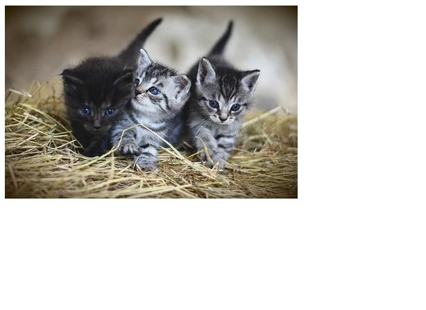
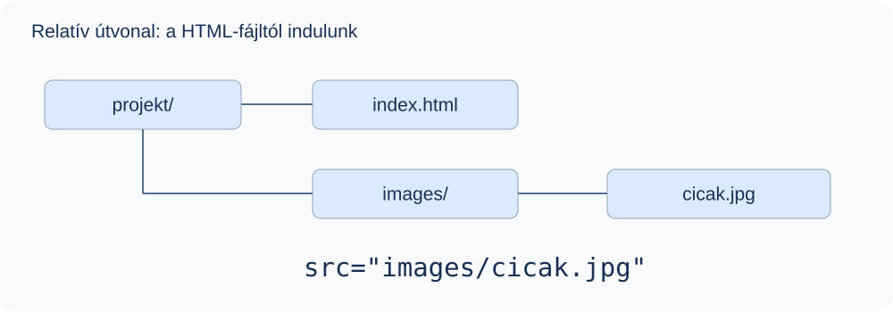
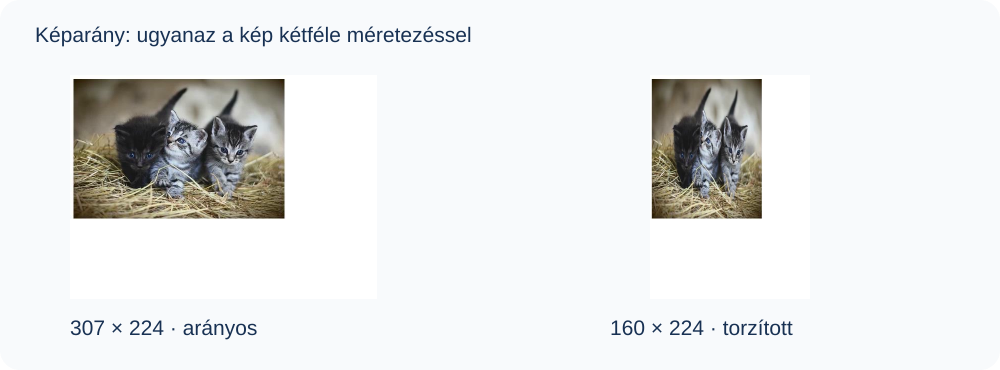

# 7. Képek beillesztése

## Mit fogsz megtanulni?

Helyes útvonallal, megfelelő alternatív szöveggel és torzításmentes mérettel illesztesz be képet.

## Az img elem

```html

```

Az `img` üres elem. Az egyszerű példákban a `src` adja meg a képfájl útvonalát; az `alt` a kép tartalmát vagy funkcióját helyettesíti szöveggel.



*A mintakép az eredeti, Oláh Katalin által összeállított tananyagból származik.*

## Mappaszerkezet és útvonal



| A kép helye az aktuális HTML-fájlhoz képest | `src` értéke |
| --- | --- |
| Ugyanaz a mappa | `cicak.jpg` |
| `images` almappa | `images/cicak.jpg` |
| Egy szinttel feljebb lévő `images` mappa | `../images/cicak.jpg` |

Külső képhez teljes URL is használható. Saját tananyaghoz praktikus a helyi fájl: nem függ egy külső szolgáltató elérhetőségétől. A példák `.jpg` és `.jpeg` kiterjesztése nem cserélhető fel pusztán a kódban: az útvonal mindig a tényleges fájlnevet kövesse!

## Képformátumok

| Formátum | Jellemző felhasználás |
| --- | --- |
| JPEG | Fénykép, veszteséges tömörítés |
| PNG | Veszteségmentes kép, átlátszóság |
| SVG | Vektoros ábra, ikon, logó |
| GIF | Egyszerű animáció, korlátozott színkészlet |
| WebP | Korszerű raszteres formátum, átlátszósággal is |

## Az alt és a title különbsége

| Attribútum | Feladat | Példa |
| --- | --- | --- |
| `alt` | A képet helyettesítő tartalom vagy funkció | `alt="Három kiscica egymás mellett"` |
| `title` | Kiegészítő információ | `title="A menhely új lakói"` |

::: warning Az alt nem egyszerűen opcionális dísz
A tananyag minden képéhez adj `alt` attribútumot. Informatív képhez rövid, értelmes helyettesítő szöveg kell; tisztán dekoratív képhez `alt=""`. Az üres attribútum és az attribútum elhagyása nem ugyanaz. A `title` nem helyettesíti az `alt` szerepét.
:::

```html
<!-- Informatív kép -->


<!-- Pusztán díszítő elem -->

```

A képernyőolvasó az alternatív szöveget használhatja; képbetöltési hibánál is ez adhat támpontot. Összetett diagramhoz a kép mellett részletes szöveges magyarázat is szükséges lehet.

## Szélesség, magasság és képarány

A `width` és a `height` HTML-attribútumok számértéke CSS-pixelben értendő; az attribútum értékébe nem írunk `px` egységet.

```html

```

A mintakép eredeti mérete 614 × 448. Arányos félmérete 307 × 224. A 200 × 250 méret ugyanennek a képnek eltérő arányt adna, ezért torzítaná.



CSS nélkül, ha csak az egyik méretet adod meg, a böngésző rendszerint a kép saját arányából számítja a másikat. Mindkét helyes méret megadása segít a hely előzetes lefoglalásában. Rugalmas megjelenítéshez:

```html

```

```css
.rugalmas-kep {
  max-width: 100%;
  height: auto;
}
```

A `max-width` megakadályozza a rendelkezésre álló hely túllépését, a `height: auto` megtartja az arányokat. Ez CSS-kiegészítés; a HTML-feladat megértéséhez elég a szerepét felismerni.

## Gyakorlás

Helyezz képet az `images` mappába! Jelenítsd meg megfelelő `alt` szöveggel, majd 300 pixel szélességgel! Figyeld meg a különbséget a helyes és egy szándékosan hibás képaránnyal megadott méret között!

::: details Hibakeresés
Ha a kép nem jelenik meg: ellenőrizd a mappát, a fájlnevet és a kiterjesztést. Ha torz: vizsgáld meg a két megadott méret arányát és az esetleges CSS-szabályokat. Ne a kép átnevezésével próbálj fájlformátumot váltani!
:::

