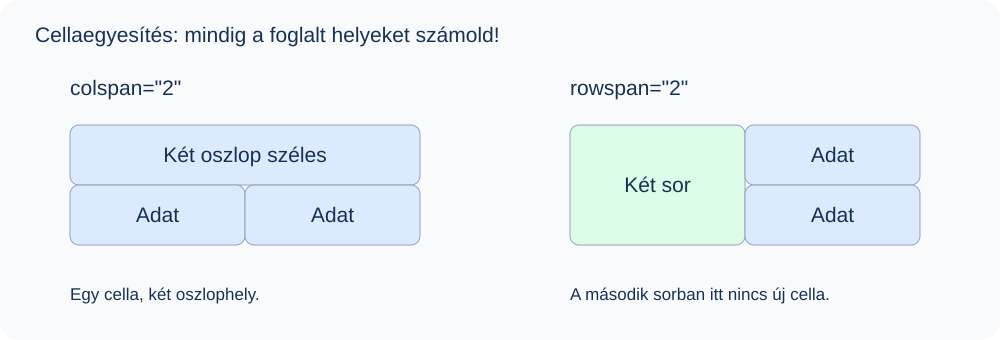

# 8. Táblázatok

## Mit fogsz megtanulni?

Egyszerű és tagolt táblázatot készítesz, összekapcsolod a fejléceket az adatokkal, majd vízszintesen és függőlegesen egyesítesz cellákat.

## A táblázat elemei

Táblázatot egymással kapcsolatban álló, sorokba és oszlopokba rendezhető adatokhoz használunk. Az oldal teljes elrendezését ne táblázattal készítsd!

| Elem | Feladat |
| --- | --- |
| `table` | A teljes táblázat |
| `caption` | A táblázat címe; a `table` első gyermekeleme |
| `tr` | Táblázatsor |
| `th` | Fejléccella |
| `td` | Adatcella |
| `thead` | Fejlécsorok csoportja |
| `tbody` | Adatsorok csoportja |
| `tfoot` | Összegző vagy láblécsorok csoportja |

A táblázat cellái nem egyszerű sorközi elemek: alapértelmezésük `table-cell`, a soré `table-row`. A HTML a kapcsolatokat, a CSS a megjelenést írja le.

## Egyszerű táblázat

::: normal-demo Cicák adatai
```html
<table>
  <caption>Cicák adatai</caption>
  <tr>
    <th scope="col">Név</th>
    <th scope="col">Fajta</th>
    <th scope="col">Életkor</th>
  </tr>
  <tr>
    <th scope="row">Dönci</th>
    <td>Sziámi</td>
    <td>1 éves</td>
  </tr>
  <tr>
    <th scope="row">Tigris</th>
    <td>Brit rövidszőrű</td>
    <td>Fél éves</td>
  </tr>
</table>
```
```css
table { border-collapse: collapse; }
th, td { border: 1px solid #94a3b8; padding: 8px 12px; }
th { background: #e0edff; color: #152c50; }
caption { font-weight: bold; padding: 8px; }
```
:::

A példa CSS-e csak a szemléltetést segíti. A HTML önmagában nem rajzol automatikusan ilyen szegélyeket. Egy sorban a `th` és a `td` vegyesen is szerepelhet; a `th` nem csak a legfelső sorban használható.

## Fejlécek összekapcsolása: scope

| Érték | A fejléccella hatóköre |
| --- | --- |
| `col` | Egy oszlop |
| `row` | Egy sor |
| `colgroup` | Oszlopcsoport |
| `rowgroup` | Sorcsoport |

A `scope` a `th` attribútuma, és az adatok értelmezését segíti. A csoportszintű értékekhez valódi oszlop- vagy sorcsoport szükséges. Összetett, többszintű táblázatoknál további fejléc-hozzárendelés is kellhet; kezdésként válassz egyszerű szerkezetet.

## Vízszintes cellaegyesítés: colspan

A `colspan="2"` azt jelenti, hogy a cella két oszlop helyét foglalja el. Ez nem két további oszlopot jelent.

::: normal-demo Két oszlop széles fejléc
```html
<table>
  <caption>Kapcsolattartási adatok</caption>
  <colgroup span="2"></colgroup>
  <thead>
    <tr><th colspan="2" scope="colgroup">Elérhetőség</th></tr>
    <tr>
      <th scope="col">Név</th>
      <th scope="col">Város</th>
    </tr>
  </thead>
  <tbody>
    <tr><td>Anna</td><td>Szeged</td></tr>
    <tr><td>Béla</td><td>Makó</td></tr>
  </tbody>
</table>
```
```css
table { border-collapse: collapse; }
th, td { border: 1px solid #94a3b8; padding: 8px 12px; }
th { background: #e0edff; color: #152c50; }
```
:::

Az első sorban egyetlen `th` szerepel, mert két helyet foglal el. Ha mellé még egy cellát írnál, az már egy harmadik oszlopot foglalna.

## Függőleges cellaegyesítés: rowspan

::: normal-demo Két sor magas fejléccella
```html
<table>
  <caption>Csoportbeosztás</caption>
  <thead>
    <tr><th scope="col">Csoport</th><th scope="col">Név</th></tr>
  </thead>
  <tbody>
    <tr><th rowspan="2" scope="rowgroup">A csoport</th><td>Anna</td></tr>
    <tr><td>Béla</td></tr>
  </tbody>
</table>
```
```css
table { border-collapse: collapse; }
th, td { border: 1px solid #94a3b8; padding: 8px 12px; }
th { background: #e0edff; color: #152c50; }
```
:::

Az első adatsor fejléccellája a következő sor első oszlopát is elfoglalja. A második adatsorba ezért csak egy új `td` kerül. A cella nem nyúlhat át egyik sorcsoportból a másikba.



::: tip Számold a foglalt helyeket!
Az oszlopszámot cellaegyesítésnél nem pusztán a címkék száma adja meg. Számold bele a `colspan` szélességét és a korábbi sorból lenyúló `rowspan` cellát is! Csak téglalap alakú terület vonható össze, L alakú nem.
:::

## Fejléc, törzs, lábléc

A tananyagban használt sorrend: `caption`, opcionális `colgroup`, `thead`, `tbody`, `tfoot`. A sorcsoportok `tr` elemeket tartalmaznak, a sorok pedig cellákat. Egy táblázatban több `tbody` is lehet, de a `tbody` mellett ne legyen közvetlen `tr` testvér.

::: normal-demo Tagolt táblázat összesítéssel
```html
<table>
  <caption>Eszközrendelés</caption>
  <thead>
    <tr><th scope="col">Eszköz</th><th scope="col">Darab</th></tr>
  </thead>
  <tbody>
    <tr><th scope="row">Monitor</th><td>4</td></tr>
    <tr><th scope="row">Billentyűzet</th><td>6</td></tr>
  </tbody>
  <tfoot>
    <tr><th scope="row">Összesen</th><td>10</td></tr>
  </tfoot>
</table>
```
```css
table { border-collapse: collapse; }
th, td { border: 1px solid #94a3b8; padding: 8px 12px; }
thead, tfoot { background: #e0edff; color: #152c50; }
```
:::

A csoportok szemantikailag tagolják az adatokat és segítik a célzott formázást. Nyomtatáskor a böngésző megismételheti a fejlécet. A `tbody` önmagában nem hoz létre görgetős területet; ahhoz külön elrendezés és CSS kell.

## Oszlopok csoportosítása: colgroup és col

A `colgroup` oszlopokat fog össze, a benne lévő üres `col` elemek egy-egy oszlopra vagy oszlopcsoportra vonatkozhatnak. A `span="2"` két oszlopot jelöl ki, nem von össze cellákat.

::: normal-demo Egységes oszlopháttér
```html
<table>
  <caption>Macskák</caption>
  <colgroup>
    <col style="background-color: #dbeafe; width: 100px;">
    <col span="2" style="background-color: #f1f5f9; width: 150px;">
  </colgroup>
  <tbody>
    <tr><th scope="row">Dönci</th><td>Sziámi</td><td>1 éves</td></tr>
    <tr><th scope="row">Tigris</th><td>Brit rövidszőrű</td><td>Fél éves</td></tr>
    <tr><th scope="row">Cilike</th><td>Perzsa</td><td>1 éves</td></tr>
  </tbody>
</table>
```
```css
table { border-collapse: collapse; color: #172b4d; }
th, td { border: 1px solid #94a3b8; padding: 8px 12px; }
```
:::

Az oszlopokon csak korlátozott CSS-tulajdonságok működnek: például háttér, szélesség, bizonyos feltételekkel szegély és láthatóság. A szövegszínt vagy igazítást a cellákon állítsd be. A cellák saját háttere elfedheti az oszlop hátterét.

## Gyakorlás

Készíts háromoszlopos táblázatot három tanuló nevével, osztályával és pontszámával! Legyen címe, oszlopfejléce és összegző sora! Ezután külön példában két azonos osztályt jelölő cellát vonj össze függőlegesen.

::: details Önellenőrzés
A cím `caption`, a fejlécek `th scope="col"` elemek. Az adatsorok `tbody`, az összegzés `tfoot` részen legyenek. Függőleges összevonáskor a második sorban ne írd ki újra a már foglalt cellát! Az összevonást ugyanazon `tbody` belsejében végezd.
:::
